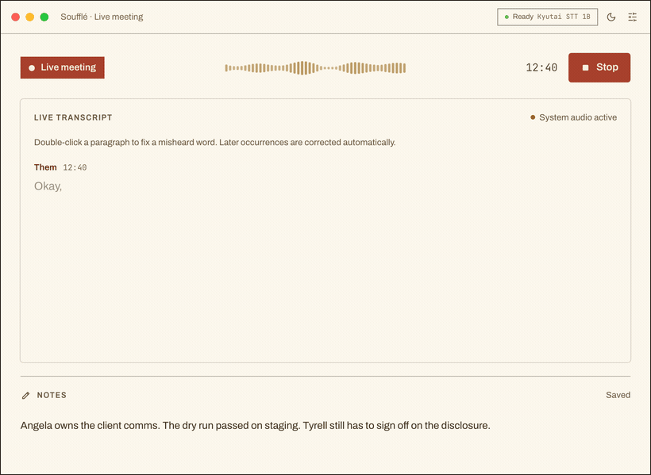
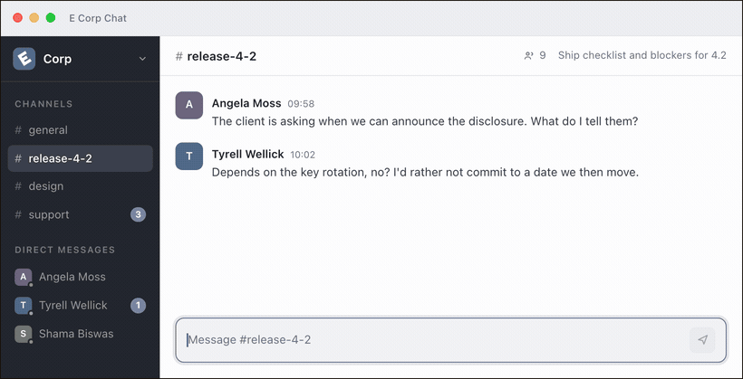
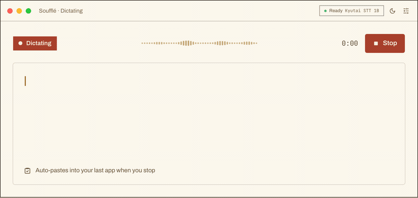
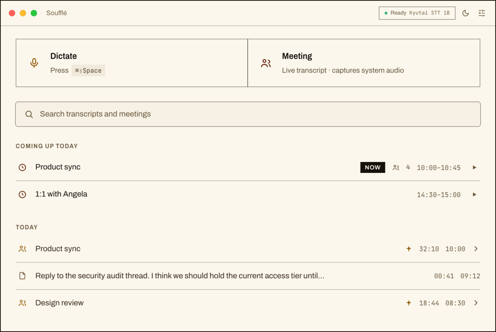

<div align="center">


<h1>Soufflé</h1>

<p><strong>Private speech-to-text for macOS, local by default.</strong></p>

<p>
  Dictate into any app, transcribe meetings that tell your voice from everyone else's, and get<br>
  experimental on-device summaries with decisions and action items. No built-in cloud AI service, accounts or API keys.
</p>

<p>
  
  
  
  
</p>

<p>
  <a href="#download"><strong>Download</strong></a> ·
  <a href="#meetings-that-know-who-is-talking">Meetings</a> ·
  <a href="#dictation-straight-into-the-app-you-are-already-in">Dictation</a> ·
  <a href="#requirements">Requirements</a> ·
  <a href="#speech-models">Speech models</a> ·
  <a href="#build-from-source">Build from source</a>
</p>

</div>

<p align="center">
  
</p>

## Meetings that know who is talking

System-audio capture separates **Me** from **Them** in the live transcript, with no virtual audio device to install. Kyutai, Whisper and Parakeet all support separate meeting lanes. The recording looks after itself: it notifies you when a calendar meeting begins (today's events also get a start button on Home), notices when the meeting seems over and stops on its own after warning you, closes cleanly when the Mac sleeps and offers to resume on wake, and recovers or salvages the session if the engine stalls or the microphone disappears. If a microphone stops responding, a banner offers *Restart Soufflé*.

- **Live transcript** with editable notes, and the calendar's participants, beside it. Click a word to add a dictionary alias for it.
- **Resume recording** on a stopped meeting adds another session to the same meeting.
- **From a meeting's page**: copy the transcript, export it (Markdown, JSON, SRT/VTT, or the audio as `.ogg`), or delete it. Experimental summaries and their templates become available after enabling Settings > AI > Summarization.
- **Optional audio**, kept as compact Opus files for 7 days, 30 days or until you delete them, replayable with click-to-seek from any line. A meeting with system audio is stored as stereo (left = you, right = the other participants) so the two sides can be separated later, for example with `ffmpeg -map_channel 0.0.0` / `0.0.1`; the built-in player plays them mixed. Stereo costs about 1.5x the disk of a mono recording.
- **Corrections that stick**: fix a misheard name by hand and Soufflé can keep that spelling, in a custom dictionary you can also edit yourself. *Learn from corrections* (Settings > Transcription) either offers suggestions after a paste and during a meeting, or learns automatically after a paste only. Learning after a paste needs auto-paste on and a successful paste.
- **Experimental summaries and compaction**, off by default. Enable **Summarization** in Settings > AI to reveal provider/model selection, prompt templates, compaction and meeting generation actions. Apple Intelligence or Ollama can attempt summaries, decisions, action items and open questions; long-meeting quality remains under evaluation.

### Experimental meeting summaries and compaction

Accurate local meeting transcription is already demanding. Faithfully summarizing a long transcript with a local model is harder: conditions, negations, owners and deadlines can disappear. Soufflé prioritizes useful transcripts across supported Apple Silicon Macs, including modest configurations. A Mac with 48 GB or more of unified memory can use larger models and may obtain better results, but that hardware should not be required to use the app.

A roughly 15-minute meeting is a more approachable starting point, not a guaranteed cutoff. Apple's on-device model has a [4,096-token context window](https://developer.apple.com/documentation/foundationmodels/managing-the-context-window), shared by instructions, input and output. Context varies across 7–8B models; a large advertised window does not remove memory, speed or long-text reliability constraints. Intermediate summary stages help fit the input but can also lose information.

We are experimenting with Microsoft's LLMLingua-2 MeetingBank model to extract a shorter input from original words before long-summary intermediate stages. The fixed target retains **65%** of the text, removing roughly a third. The compact made for a long summary is saved with the meeting as a readable version; manual compact generation does not require a summary provider. This is lossy extraction, not a validated summary or a substitute for the original transcript. Disabling Summarization hides its settings and meeting actions while preserving preferences and saved data. Dictation polish keeps its own switch and provider configuration.

You can also use the read-only MCP server with a compatible client to let Claude, ChatGPT or another cloud LLM summarize original transcripts and feed your second brain. This works independently of the experimental in-app switch. Soufflé provides a local stdio server, so connection setup depends on the client; it ships no direct cloud AI integration or automatic cloud sync. If you choose that workflow, the external client sends text to its provider and manages your notes. [Experimental feature details](docs/engineering/meeting-compression.md).

## Dictation, straight into the app you are already in

Soufflé is not a window you type into. Press the shortcut and a small pill appears above whatever you are working in; when you stop, the text lands in the field your cursor was already in. Chat, mail, an editor, a terminal: the pill does not care which, and it is excluded from screen capture, so it does not turn up in the meeting you are in.

<p align="center">
  
</p>

- **Press once to start and stop**, or bind a push-to-talk key and hold it instead. Either shortcut can be a classic combo or a single key: a lone left or right modifier, or F5–F12. Press Esc to throw away a toggle dictation in progress, and use *Pause Shortcut (1h)* in the menu bar when you need the key for something else.
- **Voice snippets**: say a trigger phrase at the start of a dictation to paste a prepared block instead; that take skips the polish pass.
- **Insertion that fits the app**: the clipboard and ⌘V, simulated typing for terminals and secure fields that reject a synthetic paste, or a direct write through Accessibility.
- **Polish before it lands** (on by default when a provider is available): a local LLM pass tidies the phrasing, with editable prompt templates — clean up, professional email, bullet points, remove fillers.
- **Optional start/stop sounds**, so you know the shortcut landed. The menu bar can also copy the last transcription.
- **Nothing lost when a paste fails**: the text waits on Home under *Dictation to recover* until you copy or delete it.

## Text arrives while you are still talking

With the default model the transcript streams in, punctuated and capitalised, instead of appearing all at once when you stop. French and English on the same model, with no language to switch.

<p align="center">
  
</p>

## Everything you record, grouped by day

Meetings and dictations land on one timeline, with today's calendar above it, searchable by meeting title and dictation text.

<p align="center">
  
</p>

## Private by design

- 🔒 **Local by default.** Transcription and storage stay on your Mac. Text processing stays local with Apple Intelligence or localhost Ollama; remote Ollama and external cloud MCP clients are choices you make. Export or delete your local database whenever you like; to wipe it, quit and delete `~/Library/Application Support/com.souffle.desktop/`.
- ✈️ **Works offline.** Once the speech model is on disk, transcription keeps working with the Wi-Fi off.
- 🙅 **No account, ever.** No sign-up, no subscription, no API key to paste in. Every outbound connection the app makes is listed [below](#what-touches-the-network).
- 🚀 **Launch at login** (optional): open Soufflé automatically when you start your Mac. Off by default; the last step of the setup wizard has a switch for it, as does Settings > System.

## Own your data

- **Export any meeting** as Markdown, JSON, or SRT/VTT subtitles, or the **whole archive** as a plain folder of Markdown and JSON.
- **MCP server**: the bundled `souffle-mcp` sidecar lets Claude Desktop, Claude Code or any MCP client search and read your meetings and dictation history. Local and read-only, and it works even when the app is closed. See [MCP server](#mcp-server).
- **Headless CLI**: transcribe a WAV file, benchmark a model, or summarize and compact a stored meeting without opening the app. See [Command line](#command-line).

## Command line

The `souffle` binary ships inside the app bundle and is not added to your `PATH`, so it is not a global command. Invoke it by full path, or symlink it once:

```bash
# Run directly
"/Applications/Soufflé.app/Contents/MacOS/souffle" --list-engines

# Or expose it as a `souffle` command
ln -s "/Applications/Soufflé.app/Contents/MacOS/souffle" /usr/local/bin/souffle
```

The binary runs headless only when the command line contains one of the six actions below. Anything else **opens the app**, including a bare `souffle --help` or an unknown flag on its own. To print the help, put an action next to it: `souffle --list-engines --help`. There are no subcommands and no `--version`.

### Actions

| Action | What it does |
| --- | --- |
| `--list-engines` | List the engine ids and labels. |
| `--list-models` | List every engine, model and backend combination, with `installed` or `not installed`. |
| `--transcribe-file <WAV>` | Transcribe a WAV file and print the text. |
| `--summarize-meeting <ID>` | Summarize a stored meeting, save the summary with it and print the meeting. |
| `--compact-meeting <ID>` | Save and print a compact transcript of a stopped meeting (experimental). |
| `--aec-replay <WAV>` | Developer tool: replay an echo-cancellation diagnostic recording. See [Audio diagnostics](#audio-diagnostics). |

`--compact-meeting` and `--summarize-meeting` cannot be combined with each other or with any other action. `--aec-replay` cannot be combined with `--transcribe-file` or a list. If both lists are given, `--list-engines` wins, and a list takes precedence over `--transcribe-file`. An option that does not apply to the action is ignored.

`--json` switches the output to JSON (`--aec-replay` always prints JSON).

### Transcribe a file

```bash
souffle --transcribe-file audio.wav
souffle --transcribe-file audio.wav --json
souffle --transcribe-file audio.wav --engine whisper --repeat 5
souffle --list-models --json    # [{"engine":…,"model":…,"backend":…,"installed":…}]
```

The WAV must be mono, 16-bit PCM or 32-bit float. Any sample rate is accepted and resampled. For a stereo or compressed source, convert first, for example with `ffmpeg -i input.m4a -ac 1 output.wav`. The speech model must already be downloaded: this action never downloads it. The text is the engine's own output, without the app's dictionary or filler filters.

| Option | Effect |
| --- | --- |
| `--engine <ID>` | Engine id, as printed by `--list-engines`. |
| `--model <ID>` | Model id, as printed by `--list-models`. |
| `--backend <ID>` | Runtime backend id, as printed by `--list-models`. |
| `--repeat <N>` | Transcribe the file N times (default 1, 0 counts as 1). The model is loaded once and the engine state is reset between runs, so this works as a benchmark. |
| `--json` | Print one JSON object on one line, and only log warnings. |

Without `--engine`, `--model` and `--backend`, the command uses the model selected in the app, and falls back to the default model with a warning on stderr if the settings cannot be read. As soon as one of the three is given, the saved selection is ignored: the engine defaults to `kyutai`, the model to the engine's first one and the backend to the model's recommended one. So pass `--engine` with a non-Kyutai `--model`. Transcription always reads the app's own database: `--database` and `SOUFFLE_DB` do not apply to it.

Text output shows the profile used and its source, the audio duration, the wall time and speed of each run, the best and median when there are several, then the transcript. JSON output:

```json
{"text":"…","audio_seconds":12.5,"engine":"…","model":"…","backend":"…","profile_source":"persisted_settings","runs":[{"wall_ms":900.0,"rtf":13.9}]}
```

`profile_source` is `flags`, `persisted_settings` or `default`. `rtf` is the audio duration divided by the processing time, so higher is faster. With several runs, `text` is the result of the last one.

### Summarize or compact a meeting

Meeting ids come from the MCP server (`list_meetings`). Both actions are experimental and work whether or not **Summarization** is enabled in the app.

```bash
souffle --summarize-meeting MEETING_ID
souffle --summarize-meeting MEETING_ID --summary-provider ollama --json
souffle --summarize-meeting MEETING_ID --summary-model qwen2.5:7b --summary-compression on
souffle --compact-meeting MEETING_ID --json
souffle --summarize-meeting MEETING_ID --database /path/to/copy.db
```

| Option | Effect |
| --- | --- |
| `--summary-provider <auto\|apple-intelligence\|ollama>` | Which provider picks the model when `--summary-model` is absent. `auto` prefers Apple Intelligence, then Ollama. For Ollama, the model saved in Settings is used if available, otherwise the first one listed. Defaults to the saved choice. |
| `--summary-model <ID>` | Use this model: `apple-intelligence`, or an Ollama model name. The model id then decides the provider. |
| `--summary-compression <on\|off>` | Override the *Compress long transcripts before summarizing* switch. It only matters for a transcript long enough to need intermediate stages. A summary never downloads the compression model: without a current compact or an installed model, the original transcript is summarized. |
| `--database <PATH>` | Database to use. Without it, `SOUFFLE_DB` is used, then the app's database. |
| `--json` | Print the result as JSON on one line, and only log warnings. |

These overrides apply to one run and are not saved. The other settings, such as the Ollama address and the default summary template, are read from the database in use. That database is opened for writing: a missing file is created and an older one is migrated, so point `--database` at a copy if you do not want it changed.

`--summarize-meeting` prints the saved meeting as JSON (indented, or on one line with `--json`), with its `summary`, `structured_summary`, segments and metadata.

`--compact-meeting` needs a stopped meeting. It returns the existing compact if it is still current. Otherwise it generates one, downloading the compression model first if it is missing (about 713 MB). It prints the compact text, or with `--json` an object with `text`, `model`, `rate`, `generated_at`, `is_stale`, `source_sha256` and `approx_tokens`. See [experimental feature details](docs/engineering/meeting-compression.md).

### Logs and exit codes

Results go to stdout, logs to stderr. `SOUFFLE_LOG` sets the log filter (for example `SOUFFLE_LOG=souffle=debug,warn`); the default is `souffle=info,warn`, or `souffle=warn,warn` with `--json`.

| Exit code | Meaning |
| --- | --- |
| `0` | Success, or help printed. |
| `1` | Invalid arguments, a setup problem (unknown profile, model not downloaded, unreadable WAV, model load failure), or a failed meeting action or replay. |
| `2` | The transcription itself failed. |

## MCP server

`souffle-mcp` is a local [Model Context Protocol](https://modelcontextprotocol.io/) server that talks over stdio. It opens the Soufflé database **read-only** and works with the app closed. The server makes no network connection of its own, but the client you connect can send what it reads to its own AI provider, under that client's privacy settings. It gives access to meetings **and** dictation history.

It ships inside the app bundle and takes no arguments:

```
/Applications/Soufflé.app/Contents/MacOS/souffle-mcp
```

Settings > System > MCP server shows the two snippets below with the path of your installation filled in, each with a *Copy* button.

### Claude Code

```bash
claude mcp add souffle '/Applications/Soufflé.app/Contents/MacOS/souffle-mcp'
```

By default this registers the server for you in the current project only. To have it in all your projects:

```bash
claude mcp add --scope user souffle -- '/Applications/Soufflé.app/Contents/MacOS/souffle-mcp'
```

Check it with `claude mcp list`, or `/mcp` inside Claude Code. Remove it with `claude mcp remove souffle`.

### Claude Desktop

1. In the Claude menu of the macOS menu bar, open **Settings…**, then **Developer** > **Edit Config**. The file is `~/Library/Application Support/Claude/claude_desktop_config.json`.
2. Add the server. If the file already has an `mcpServers` object, add only the `souffle` entry to it.

   ```json
   {
     "mcpServers": {
       "souffle": {
         "command": "/Applications/Soufflé.app/Contents/MacOS/souffle-mcp"
       }
     }
   }
   ```

3. Quit Claude Desktop completely and reopen it.

If the server does not appear, look at `mcp.log` and `mcp-server-souffle.log` in `~/Library/Logs/Claude`. Other MCP clients work the same way: run the binary as a stdio server.

### Which database

The server reads `~/Library/Application Support/com.souffle.desktop/souffle.db`. The sidecar inside the Soufflé Nightly bundle reads the Nightly database instead. The `SOUFFLE_DB` environment variable overrides both: set it in an `env` object next to `command` in Claude Desktop, or with:

```bash
claude mcp add --env SOUFFLE_DB=/path/to/souffle.db --transport stdio souffle -- '/Applications/Soufflé.app/Contents/MacOS/souffle-mcp'
```

### Tools

There are five tools. `limit` defaults to 20 and is kept between 1 and 200. There is no pagination.

**`list_meetings`**: meetings, newest first.

| Parameter | Meaning |
| --- | --- |
| `query` (optional) | [FTS5](https://www.sqlite.org/fts5.html#full_text_query_syntax) filter on the transcript text only, not titles, notes or summaries. Quote a phrase or a hyphenated word: `"follow-up"`. A blank value means no filter. |
| `from` (optional) | Earliest start time, inclusive: an ISO 8601 date or date-time, read as UTC without an offset. |
| `to` (optional) | Latest start time, inclusive. A date alone means midnight at the **start** of that day, so `to: "2026-03-05"` leaves out meetings later on the 5th: pass the next day. |
| `limit` (optional) | Maximum number of meetings. |

Returns `meetings`, each with `id`, `title`, `started_at`, `ended_at`, `is_ongoing`, `duration_seconds`, `participants` (names), `has_summary`, `has_compact` and `has_notes`. A date that cannot be parsed matches nothing.

**`get_meeting`**: one meeting.

| Parameter | Meaning |
| --- | --- |
| `id` (required) | Meeting id from `list_meetings` or `search_meetings`. |
| `include` (optional) | Any of `transcript`, `summary`, `notes`, `metadata`, `compact`. Omitted or empty means everything. An unknown value is rejected. |

Always returns `id`, `title`, `started_at`, `ended_at`, `is_ongoing` and `duration_seconds`, plus the following, `null` when not requested or absent:

- `transcript`: the edited transcript if you edited it, otherwise paragraphs prefixed with `Me:` or `Them:` when the speaker lane is known, without timestamps.
- `summary` and `structured_summary` (`decisions`, `action_items` with `text` and `owner`, `open_questions`), both selected by `summary`.
- `notes`: your meeting notes.
- `metadata`: `calendar_event_id`, `participants` (`name`, `email`, `is_organizer`), `summary_model`, `summary_generated_at` and `segment_count`.
- `compact_transcript`, selected by `compact`: `text`, `model`, `rate` (share of the text it aimed to keep), `generated_at`, `is_stale`, `source_sha256` and `approx_tokens` (an estimate).

Use the summary for an overview, the compact for an economical but lossy first pass (check `is_stale`), and the transcript for exact quotes.

**`search_meetings`**: full-text search over meeting transcripts.

| Parameter | Meaning |
| --- | --- |
| `query` (required) | FTS5 query. A blank query returns nothing. Titles, notes, summaries and dictations are not searched. |
| `limit` (optional) | Maximum number of hits. |

Returns `results`, ranked by relevance, each with `id`, `title`, `started_at` and a short `snippet` where matches are wrapped in `**` and cuts are marked `...`.

**`get_latest_meeting`**: the meeting that started last. It takes the optional `include` of `get_meeting` and returns the same fields.

**`list_dictations`**: dictation history, newest first. It takes the optional `limit` and returns `entries` with `id`, `text` and `timestamp`. It has no search or date filter.

### Meeting resource

Each meeting is also a resource, `souffle://meeting/{id}`. Resource listing returns the 200 most recent meetings, named by title, without a next page; any meeting id can be read. Reading one returns Markdown with the title, start time, summary, decisions, action items, open questions (each section only when present) and the transcript. Notes and the compact transcript are not included: use `get_meeting` for those. No resource templates are advertised.

### Ongoing meetings, errors

An ongoing meeting can be read live: `ended_at` is `null` and `is_ongoing` is `true`. Segments are saved in batches, so the latest ones (up to about 15) may be missing, and newly saved live text is generally not searchable until the session ends.

| Symptom | Cause |
| --- | --- |
| The server exits at startup with *Souffle database not found* | Launch Soufflé at least once, or fix `SOUFFLE_DB`. |
| Every call reports a newer schema version | The database was written by a newer Soufflé than this sidecar. Update the app and restart the MCP client. |
| *Query failed* on a search | Invalid FTS5 syntax: quote the terms. |
| *Meeting not found*, *No meetings found* | Unknown id, or no meeting recorded yet. |

From a source checkout, `scripts/build-mcp-sidecar.sh --debug` or `cargo build --manifest-path app/Cargo.toml -p souffle-mcp` builds the sidecar.

## Speech models

All models run locally and are downloaded on first use from HuggingFace:

- [Kyutai STT 1B](https://huggingface.co/kyutai/stt-1b-en_fr-candle) (default): French + English, ~2.4 GB, Metal GPU via Candle. Streams text while you speak.
- [Kyutai STT 2.6B](https://huggingface.co/kyutai/stt-2.6b-en-candle): English only, higher quality, ~5.6 GB. Streams text while you speak. It has no pause detector, so long speech without a quiet gap can lose about 2.5 seconds every 28 seconds.
- [Whisper Large V3 Turbo](https://huggingface.co/ggerganov/whisper.cpp): multilingual, ~1.6 GB, Metal GPU. Supports progressive transcription and separate Me/Them meeting lanes.
- [Parakeet TDT 0.6B v3](https://huggingface.co/istupakov/parakeet-tdt-0.6b-v3-onnx): 25 languages with punctuation and capitalization, ~670 MB int8, CPU inference. Supports progressive transcription and separate Me/Them meeting lanes.

Kyutai streams words as you speak. Whisper and Parakeet show progressive previews and finalize the transcript when you stop.

## Requirements

- **Apple Silicon Mac.** There is no Intel build.
- **macOS 13 or newer** for dictation.
- **macOS 14.4 or newer** for meetings that capture the other participants. System-audio capture uses the Core Audio process tap, which does not exist before 14.4; on macOS 13 a meeting still records, but only your microphone, and the app shows *Mic only*.
- **Disk space for the speech model**, downloaded on first use: ~670 MB for the smallest, ~2.4 GB for the default. See [Speech models](#speech-models).
- **Experimental summaries**, when explicitly enabled, need either Apple Intelligence, which requires macOS 26 or newer, or a local [Ollama](https://ollama.com/) on any supported version. Transcription itself needs neither.

## Permissions

The setup wizard has an optional Permissions step; skip it and Soufflé asks for each of these as you use the feature that needs it. Notifications are the exception, requested at launch:

| Permission | Why | Needed for |
| --- | --- | --- |
| Microphone | Records your voice to transcribe it | Everything |
| System Audio Recording | Captures what the other participants say, without a virtual audio device | Meetings (macOS 14.4+) |
| Accessibility | Pastes into the app you were using, reads back your corrections after a paste when *Learn from corrections* is on, and installs the native event tap for single-key shortcuts (lone modifier, F5–F12) | Auto-paste, dictation polish, single-key shortcuts |
| Calendar | Reads today's events to list them on Home and notify you when one starts | Calendar integration (optional) |
| Notifications | Calendar reminders, a meeting about to stop on its own, a paste that failed | Those alerts only |

Settings > System > Permissions shows the current state of each and links straight to the matching System Settings pane.

## What touches the network

The privacy claim above is worth checking rather than believing, so here is every outbound connection the app makes:

- **huggingface.co**, to download a speech model the first time you select it. Nothing is sent, and once the model is on disk transcription works offline forever.
- **api.github.com**, at launch and then about once a day to ask whether a newer release exists, and whenever you press *Check for updates* in Settings > System > About; it also fetches the release notes shown in What's New. The check sends nothing but the request itself: no identifier, no account, no usage data. Turn these automatic checks off in Settings > System > About.
- **github.com**, only if you press *Download update*: the signed update is fetched and verified before *Install and restart* is offered, and installing asks you to stop a running meeting first.
- **Your Ollama instance**, `http://localhost:11434` by default, if you enable summaries with Ollama. It is your machine unless you point it elsewhere. A model you download from Settings > AI is pulled by that instance, not by Soufflé.

Audio, transcripts, notes and summaries are stored in a local SQLite database: Settings > System > Data exports the lot, and deleting the data folder removes it. Local Apple Intelligence and localhost Ollama keep text processing on this Mac. A remote Ollama server or an external cloud MCP client you choose receives the text needed for its work.

## Status

Open source and actively developed. Every release is signed and notarized, and the engineering is covered by a large test suite. Macs differ enormously in audio hardware and routing, so if something does not behave on yours, a report is genuinely useful.

The fastest useful bug report is *Copy diagnostics* in Settings > System > Diagnostics, which copies the app version, the current pipeline state, whether detailed logging is on and the data and log paths, plus the last lines of the log. Paste that into a [new issue](https://github.com/damione1/souffle/issues/new/choose) with your macOS version, your Mac model and what you were doing. Transcript log lines are removed and your home folder is written as `~`.

The **Detailed logging** switch on the same page raises the log to Debug level and writes the recognised text to the log file on your Mac; those lines are removed from the copied diagnostics. While it is on, the first 3 seconds of microphone input of a dictation or meeting can also be written to a file in the data folder, which is deleted when the session ends. Developers can set `SOUFFLE_LOG` (for example `SOUFFLE_LOG=souffle=trace,warn`) to choose the log filter for one launch; it takes precedence over the switch.

## Download

Install with [Homebrew](https://brew.sh/):

```bash
brew install --cask damione1/tap/souffle
```

Or grab a prebuilt installer from the [**Releases**](https://github.com/damione1/souffle/releases/latest) page: a `.dmg` for Apple Silicon Macs. See [Requirements](#requirements) for the macOS versions.

## Build from source

The app is Rust with a native [Slint](https://slint.dev/) interface (`app/souffle-slint`), plus a little Swift for the overlay. There is no Node.js, webview or npm step. Requires an Apple Silicon Mac, [Rust](https://rustup.rs/), the Xcode command-line tools, and [cmake](https://cmake.org/) (`brew install cmake`).

```bash
git clone https://github.com/damione1/souffle.git
cd souffle
make nightly
```

`make nightly` builds and opens **Soufflé Nightly**, which has its own data and permissions and can run alongside the installed app.

Daily PRs run quick formatting, lint and contract tests. Full native validation
runs when promoting to `master` or launching it manually; see the [CI policy](docs/engineering/ci.md).

## Audio diagnostics

To investigate speaker audio leaking into the microphone, start the app from a terminal with `SOUFFLE_AEC_DIAGNOSTIC=1`. This is a developer tool with no setting: the capture only runs for that launch, and only while meeting-audio retention is enabled in Settings > System > Data.

The extra WAV stores the microphone on the left and system audio on the right, before echo cancellation. It uses about **1.38 GB per hour**, stops after one hour, and follows your audio-retention setting. Keep it private: it contains the meeting audio. Replay it with `--aec-replay <WAV>`.

## License

Copyright (c) 2026 Damien Goehrig.

Released under the GNU General Public License v3.0 or later (GPL-3.0-or-later). You are free to use, study, modify, and redistribute this software, provided that derivative works are also published under the same license. See [LICENSE.md](LICENSE.md) for the full text.

Meeting summaries and compaction are experimental and off by default behind Settings > AI > Summarization. [Model distribution, CLI and MCP details](docs/engineering/meeting-compression.md).
