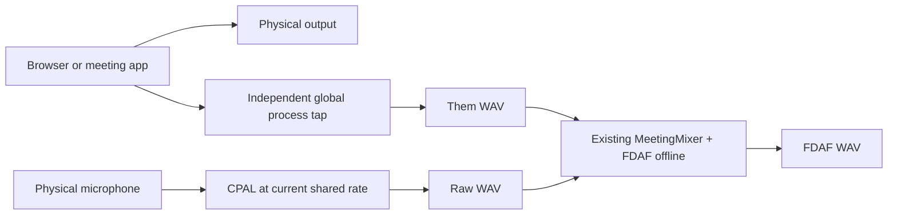
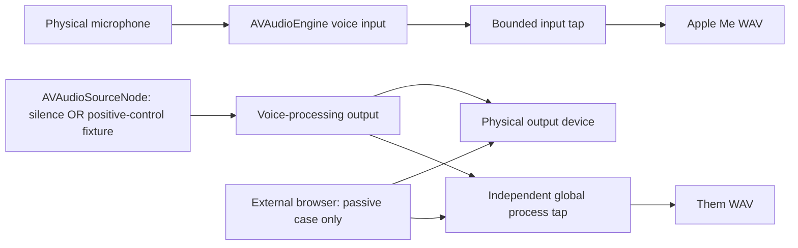

# SOU-277: native Apple voice-processing probe

**Investigation incomplete. No acoustic capture was run during implementation.**
Damien owns the physical trials, permissions, listening and meeting-app checks.
Nothing here demonstrates external-browser echo rejection or justifies enabling
Apple processing by default. The reported transcript flash remains unrelated and
uninvestigated. Production capture, settings, retention, ASR adapters and Slint UI
are unchanged. The only production source additions are read-only accessors for
the existing system-tap drop counter and teardown-failure flag.

## Build and isolation

From this worktree, build and Developer-ID-sign the separate development bundle:

```sh
./scripts/build-aec-probe.sh
probe="$PWD/app/target/aec-probe/Souffle AEC Probe.app/Contents/MacOS/souffle-aec-probe"
"$probe" --help
```

The script accepts `APPLE_SIGNING_IDENTITY` and `CARGO_TARGET_DIR`, targets macOS
13.0, verifies its signature, and runs help only. Bundle identifier is
`com.souffle.dev.aec-probe`. Microphone and system-audio purpose strings and input
entitlements belong to this bundle. Launch its signed executable, grant the
probe's permissions, and confirm its entry in System Settings. Terminal may also
be identified as the responsible launcher by TCC; record what macOS actually
shows. Never reset the installed or Nightly app's TCC. A first permission prompt
may invalidate the warmup or capture: archive that attempt and repeat after grants.

AVAudioEngine's voice-processing APIs exist on macOS 13; the minimum ducking
selector is checked dynamically before use (macOS 14+). **The full paired probe
requires macOS 14.4+ for the existing system tap.** An unsupported tap is an
explicit failed attempt, not a silent Them channel. A build targeting 13 is not
physical validation on 13. Record actual machine/OS from the manifest. No Swift,
Python, Node, Apple Speech or Apple Intelligence API was added by this probe.

## Actual graphs





The native engine is stopped while enabling processing. It explicitly disables
AGC and bypass, checks input **and** output voice-processing readbacks, installs
an input tap, and connects a mono source to the real output using the negotiated
microphone format. It verifies exact input/output format equality before start;
non-mono native input is rejected by this probe. Native output runs
silence in the external-browser trials. For `--positive-control`, only the fixed
fixture is played once through that source, after the countdown, then silence.
The captured global tap is **never routed back to the speakers**. Input samples
from Apple never enter FDAF. No simultaneous CPAL/native claim is made.

`manifest.json` records actual NSError results for activation/start, readbacks,
formats, presentation latencies and ducking configuration. Minimum ducking is
not zero ducking; operator volume/listening observations remain necessary.
A successful configuration readback proves API state, not effective AEC.

Native callbacks copy to a preallocated bounded ring or fill supplied output
buffers. They do not write files, run ASR, allocate PCM, or wait on a lock (the
input producer uses `try_lock`; contention counts as loss). The worker collects
at most 60 seconds, then writes PCM and performs baseline replay. System capture
reuses the existing dispatch-queue tap and its loss counter, without orphan sweep.
Both input rates and the real output rate are retained. CPAL refuses to open if
no f32 configuration supports the **current** hardware rate; no repair/reset or
96-kHz request is made. The native engine negotiates its own formats, and any
observed shared-rate change invalidates the comparison attempt.

## Fix the protocol before recording

```sh
qa="$HOME/Souffle-QA/SOU-277-$(date +%Y%m%d-%H%M%S)"
mkdir -p "$(dirname "$qa")"
"$probe" init "$qa"
fixture="$PWD/app/fixtures/audio/sou-184/ecorp-q4-intro.wav"
shasum -a 256 "$fixture"
```

The supplied `ecorp-q4-intro.wav` is 78.641208 seconds (metadata only, no
playback performed). Prepare a 30-second derivative with the fixed pause/resume
schedule before using it; the native positive-control loader rejects files
longer than 60 seconds. Point the protocol at the derivative and hash that file.

Edit `$qa/protocol.json`. The directory is private (0700); never commit its WAVs,
transcripts or private references. Required fields:

- Absolute fixture path and SHA256. Use a mono WAV of at most 60 seconds. Listen
  and manually annotate the **actually audible** remote script; ASR is not gold.
  If the supplied fixture does not match the 30-second pause/resume schedule,
  prepare one fixed mono fixture outside Git before trials and hash that file.
- Exact local script, distinct from the remote script, as read over 30 seconds.
  Note the common words: they will be reported ambiguous for remote attribution.
- Position, mouth distance, output volume description, browser/version and
  exact schedule. Fix a speech/pause/resume schedule such as 0–10/10–15/15–30s.
- Set `standard_microphone_mode_confirmed` to true only after choosing Standard
  for the probe in macOS mic controls. This is an operator assertion; the probe
  does not claim to read the user-selected Voice Isolation mode.
- Pin `whisper_profile` and `parakeet_profile`: `model`, `backend`,
  `weights_sha256`. These IDs come from the **existing catalogue**, not a new
  list. Hash the downloaded weights (or a sorted manifest of every model file)
  once and retain that manifest privately; the operator must verify unchanged
  weights before the second engine's runs. The probe compares profile metadata
  but does not discover/hash model directories itself.

Use an already built develop Soufflé bundle for the existing headless ASR CLI.
Set its actual absolute path; this executable never launches the GUI for these
flags. Do not rebuild, replace, reset or launch the running Nightly for this task.

```sh
bundle="/absolute/path/to/develop/Soufflé.app"
asr="$bundle/Contents/MacOS/souffle"
"$asr" --list-models --json > "$qa/catalogue.json"
```

## Capture workflow

For each command, prepare the browser fixture or local script, wait for
`RECORDING` after the three-second countdown, and follow the same schedule.
Startup audio is discarded. Browser start timing is operator-controlled: record
its actual offset/deviation. Use integrated microphone and audible integrated
speakers at the fixed volume. Do not speak during remote-only; do not play the
fixture during local-only. In double talk both speakers pause and resume as fixed.

```sh
"$probe" capture "$qa" baseline remote 1 --notes 'none'
"$probe" capture "$qa" baseline local 1 --notes 'none'
"$probe" capture "$qa" baseline double 1 --notes 'none'
"$probe" capture "$qa" apple remote 1 --notes 'none'
"$probe" capture "$qa" apple local 1 --notes 'none'
"$probe" capture "$qa" apple double 1 --notes 'none'
```

Repeat each command with repetition `2`, then `3`. This yields the requested
**27 analysis variants**: 9 raw, 9 FDAF, 9 Apple. Raw and FDAF share the exact
same 9 pre-AEC recordings; they are not 18 statistically independent captures.
Together with 9 live Apple trials this is **18 physical recordings**. Do not
claim the Apple repetitions share PCM with the baseline. If an additional raw
physical repeat is desired, retain it as auxiliary evidence, not a replacement
for the paired raw/FDAF export.

Each trial folder contains native-rate mono mic/tap WAVs, 48-kHz `them.wav`,
`raw.wav` + `fdaf.wav` or `apple.wav`, protocol snapshot, `runtime.log` (existing tap/DSP logs, including exact CoreAudio
teardown errors), and manifest with hashes.
The baseline uses the actual production `MeetingMixer` including its energy
bypass/crossfade and default FDAF delay. It records whether route policy permits
FDAF; headphone/bypassed trials cannot enter the main comparison.

A failed/incomplete capture is kept with `valid:false` and cannot be scored.
Never overwrite an attempt: move its folder to an `archive-*` name before retry.
Record reading deviations in `--notes`; if the script differs, archive/repeat
rather than treating unspoken words as processing damage. Changing protocol
mid-series requires a new QA directory; aggregation rejects different protocols.

Positive control (stop browser playback first; the probe now plays the fixture):

```sh
"$probe" capture "$qa" apple remote 1 --positive-control --notes 'native source control; browser stopped'
```

This has its own `-control` folder and is excluded from passive comparison.
Failure of this control means the native graph has not demonstrated useful AEC;
success does not prove rejection of audio from another process.

## Coexistence and routes (operator only)

Use additional QA directories / auxiliary 60-second captures. Name meeting
application and version and record who started first in `--notes`.

```sh
"$probe" capture "$qa" apple double 1 --seconds 60 --notes 'meeting app VERSION already transmitting; probe started second'
"$probe" capture "$qa" apple double 2 --seconds 60 --notes 'probe started first; meeting app VERSION starts during capture'
"$probe" capture "$qa" apple double 3 --seconds 60 --notes 'route exercise: headset, mute/unmute, change device; exact timings recorded separately'
```

For each order verify **in the other application / remote endpoint** that local
speech remains transmitted. Harness callbacks are not evidence of this. Record
volume and mic state before/during/after, audible ducking, routes, changes and
errors, including failures. Exercise headphones, mute/unmute and device changes.
A route-changing trial normally fails stable-route comparison validation; keep
its telemetry and native WAVs as auxiliary evidence. Do not reset devices to hide
failures. No automatic recovery/rebuild is attempted by this investigation.

## ASR and metrics

For every completed trial use the same pinned weights/backend for Me and Them,
first Whisper, then Parakeet. The wrapper invokes the existing headless CLI with
explicit catalogue IDs, saves stdout/stderr and successful-run provenance, checks
exit status, file hashes and durations, then scores. No model is downloaded.

```sh
for engine in whisper parakeet; do
  for mode in baseline apple; do
    for scene in remote local double; do
      for rep in 1 2 3; do
        "$probe" transcribe "$qa/$mode-$scene-$rep" --binary "$asr" --engine "$engine" || break 4
      done
    done
  done
done
"$probe" report "$qa"
```

For a scored trial, rerun only evaluation with
`"$probe" score "$qa/apple-remote-1" --engine whisper`. Existing successful ASR
provenance is not overwritten; archive the ASR JSON if intentionally rerunning.
Transcribe the positive control separately with the same command and its folder.

Normalization is fixed: lowercase Unicode, punctuation removed (apostrophes and
hyphens removed, not split), whitespace tokens, accents retained. Local WER is
Levenshtein `(S+D+I)/reference words`; deletions and substitutions are distinct.
An empty successful local transcription produces full deletions, not perfect
preservation. Missing/failed ASR is an error. Remote-only local WER is null.
Double-talk WER uses the full Me transcript, so surviving remote speech contributes
insertions; it is not an isolated distortion score.

Remote duplicate **proxy** is ordered word overlap (LCS) of Me with remote gold,
excluding every remote word also present in local gold. Counts of excluded,
ambiguous words are retained. This avoids silently calling shared words remote,
but it is still lexical evidence, **not speaker attribution**. Listen and annotate
true remote duplicates / local missing words manually, especially shared words,
ASR substitutions and double talk. An energy reduction alone proves neither.

`comparison.json` contains every available trial and explicit missing paths,
plus per-scene/variant/engine median, min and max. It rejects stale hashes,
inconsistent protocols/profiles and auxiliary/headphone trials. `complete:true`
means the numeric matrix is populated; it never means acoustic ACs have passed.

## Measurement limits and current result

Mic telemetry includes negotiated rate, native PCM duration, dropped samples,
callback/errors, first/last CoreAudio host timestamps, and maximum timestamp-to-
worker delivery age (including the callback buffer duration). CPU is process
user+system over capture/teardown wall time, RSS is process-lifetime high-water
bytes. The probe uses Cargo’s dev profile; these are diagnostic costs, not
production performance budgets. FDAF offline DSP cost is separate, so do not compare it as live CPU against
Apple. System-tap rate, duration, callbacks and losses are recorded; its public
API does not supply sample timestamps to this dev caller. Tap/mic align at a
common drain epoch with nominal 10ms polling plus scheduling/device start phase
uncertainty (no hard bound),
**not hardware timestamp synchronization**. Same-input baseline pairing is exact,
while tap alignment and acoustic delay remain exploratory. Raw native-rate files
and timing metadata are retained for inspection. Route snapshots are sampled
once per second; fast transitions can occur between them and need operator notes.

Every main capture must have duration within 250ms of requested duration, no
reported callback loss/error, stable observed route and known unchanged hardware
rates. Native output must render. Required speech lanes cannot be all-zero PCM.
Invalid attempts remain evidence and cannot turn into zero-score wins.

| Evidence | Current status |
|---|---|
| AC1 native activation, actual graph, positive-control AEC | Harness implemented; runtime/readback/control capture pending |
| AC2 27 variants × Whisper/Parakeet, per-trial dispersion | 0 acoustic variants captured; all user runs pending |
| AC3 passive browser AEC without double playback | Silence graph implemented; external-reference effectiveness unknown |
| AC4 other-app transmission, orders, rates/volume/routes | Instrumentation and protocol provided; all operator observations pending |
| AC5 production invariants, existing tests | Isolated crate + read-only diagnostics; automatic gate in verification record |
| AC6 feasibility and next step from measurements | Incomplete; no recommendation to adopt or enable by default |

After QA, add only non-private machine/OS metadata, hashes, metrics and listening
conclusions to this report. Preserve per-trial failures and dispersion. If the
positive control works but browser echo remains, distinguish reference ownership
from a broken graph. Any product integration needs a separate ticket and agreed
thresholds for duplicates, voice loss, ducking and coexistence.

Sources: [Apple voice-processing activation](https://developer.apple.com/documentation/avfaudio/avaudioionode/setvoiceprocessingenabled(_:)),
[Apple ducking configuration](https://developer.apple.com/documentation/avfaudio/avaudioinputnode/voiceprocessingotheraudioduckingconfiguration),
[WWDC23 voice processing](https://developer.apple.com/videos/play/wwdc2023/10235/).
Implementation signatures/readback controls were checked against the installed
`objc2-avf-audio 0.3.2` generated Apple bindings and local SDK headers.
