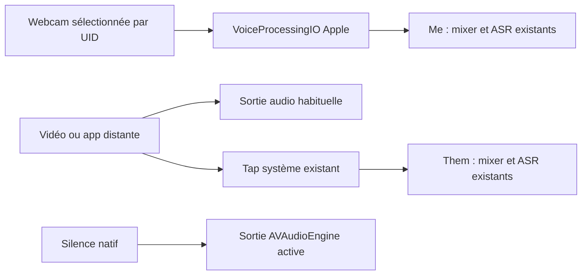

# SOU-279 — Nightly avec micro de réunion traité par Apple

Cette construction expérimentale utilise **AVAudioEngine / VoiceProcessingIO**
pour le micro des réunions. Elle reste désactivée dans les builds habituels.
La dictée utilise toujours CPAL. Aucun résultat acoustique Apple n'est encore
mesuré : une activation réussie ne prouve pas l'annulation de la vidéo distante.

## Construire et signer

Depuis ce worktree, avec l'identité Developer ID habituelle :

```sh
MACOSX_DEPLOYMENT_TARGET=13.0 ./scripts/bundle-macos.sh --debug --nightly --native-aec
codesign --verify --deep --strict 'app/target/debug/bundle/macos-native-aec/Soufflé Nightly.app'
```

`CARGO_TARGET_DIR` peut désigner le cache partagé. Le bundle reste dans ce
worktree, dans `macos-native-aec`, sans écraser le bundle Nightly de référence.
Le flag refuse un build sans `--nightly`. La feature Cargo
`experimental-native-aec` n'est pas activée par défaut ; la feature `native-voice`
partagée avec le banc n'active pas à elle seule le backend de réunion.
Le plist du bundle porte `SouffleNativeAEC=true` et le commit de construction.
La signature est vérifiée avant livraison. Le build n'ouvre aucune capture.

## Faire la seconde partie du test dans l'app

Les trois réunions FDAF déjà faites constituent la référence. Il n'est pas
nécessaire de les recommencer ni de préparer le protocole ASR du banc.

1. Quitter soi-même l'ancienne Nightly, puis ouvrir le bundle `macos-native-aec`.
   Il garde l'identité Nightly et ses préférences ; il ne réinitialise pas TCC.
2. Sélectionner explicitement **Unknown USB Audio Device** dans les réglages
   d'entrée de Soufflé, capot fermé si c'est la configuration à évaluer. Éviter
   le mode Auto pour ce QA : le refus d'un autre micro doit porter sur cette
   webcam épinglée. Son UID observé est
   `AppleUSBAudioEngine:Unknown Manufacturer:Unknown USB Audio Device:8D5A0900:3`.
   Le micro par défaut de macOS peut rester interne.
3. Garder la même vidéo, sortie, position et volume. Choisir Standard dans les
   contrôles micro macOS si ce choix est disponible. Faire trois réunions de
   30 à 40 secondes : vidéo seule, voix seule, puis vidéo et voix ensemble.
4. Relever Me/Them, les mots locaux manquants et les doublons distants, avec les
   logs de chaque session. Les captures et transcriptions restent privées.

Une erreur Apple ou un UID différent invalide le test : le chemin refuse de
basculer silencieusement vers CPAL ou vers un autre micro explicitement choisi.
Si une reconstruction échoue, la session s'arrête avec une erreur récupérable
dans l'app et sauvegarde ce qui a déjà été enregistré. Rebrancher le micro et
relancer une réunion. Aucun fallback n'est présenté comme une activation Apple
réussie. Ce refus s'applique aussi au tout premier démarrage Apple.

## Graphe et preuves à lire



Le tap n'est jamais rejoué sur les haut-parleurs. FDAF est désactivé pour tout
backend Apple, y compris après changement de route et reconstruction du micro.
AGC est désactivé et vérifié ; le bypass est désactivé ; le ducking minimum est
demandé et relu si l'API est disponible (macOS 14+). Aucune fréquence matérielle
n'est forcée. Le flux client négocié, mono f32, est resamplé par le mixer existant.

Les logs doivent contenir `Apple meeting microphone requested=... readbacks=...`
avec UID et IDs d'entrée/sortie, OSStatus des opérations CurrentDevice,
readbacks avant/après démarrage, fréquences, propriétés VoiceProcessingIO et
succès de `startAndReturnError`. Ensuite :
`Meeting backend=Apple VoiceProcessingIO, FDAF=disabled`.
Un log d'intention seul ne suffit pas : vérifier la ligne d'activation et les
readbacks. Les pertes de ring, erreurs de callback et reconstructions sont
journalisées. Les changements de périphérique/format sont contrôlés sur le
thread capture ; les callbacks ne font ni I/O disque, ni ASR, ni attente.

La capture partagée réside dans `app/src/audio/native_voice/`, utilisée par le
banc et l'app. L'app ne dépend d'aucun gold, manifeste ou protocole ASR du banc.
Le traitement est compatible avec la cible macOS 13, tandis que Them utilise le
tap existant disponible à partir de macOS 14.4. La validation physique de ces OS,
la coexistence avec une autre app, le débranchement USB et l'efficacité sur un
flux externe restent du QA matériel. Aucun agent n'a lancé ces captures.

Le correctif de fermeture Metal livré avec cette Nightly est documenté
séparément dans [SOU-280](../sou-280.md).
